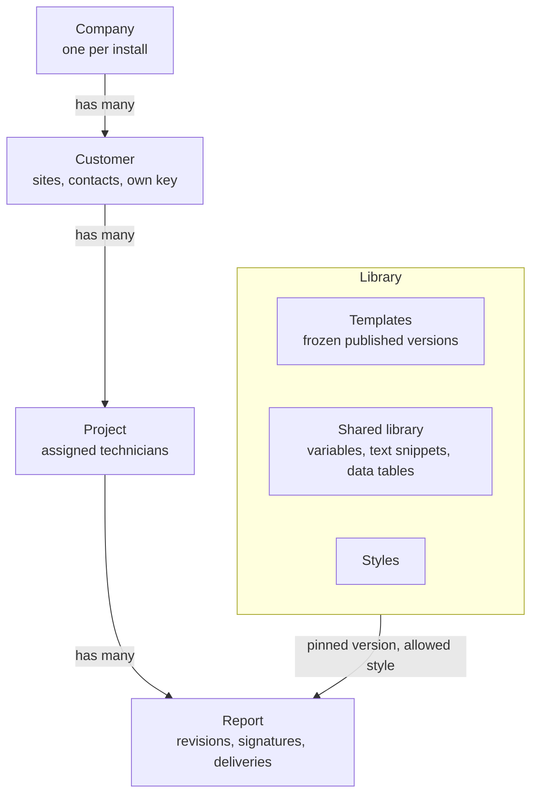
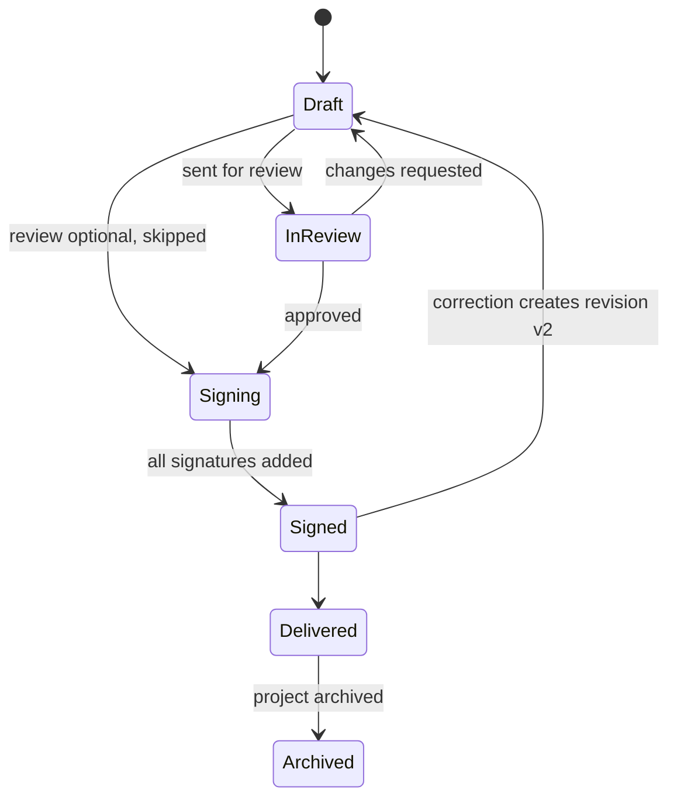
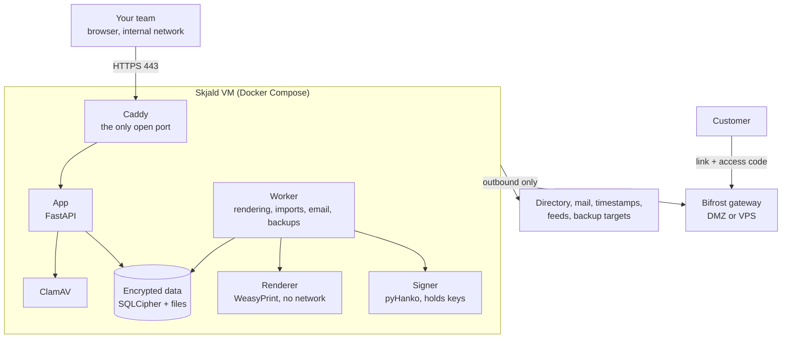

# Skjald architecture

This document describes how Skjald is designed. It is the reference for contributors and is updated as the design changes. Phase 0 is done and Phase 1 is in progress; see the roadmap at the end.

## Principles

- **One issuing company per install.** No multi-tenancy. Another company runs its own install.
- **Internal by default.** The app is reachable only on the internal network. The only part ever exposed to the internet is the optional Bifrost delivery gateway, which stores files it cannot read.
- **Security first.** Per-customer encryption keys, MFA for every account, need-to-know access and a tamper-evident audit log. The engineering baseline is OWASP ASVS Level 2.
- **Templates are files.** Every template, built-in or custom, exports and imports as one `.skjald` file.
- **Easy to install.** One command on a fresh Ubuntu Server LTS VM, plus a verifiable install path.
- **Reports worth keeping.** Signed, timestamped PDF/A files that still verify years later.

## Data model



- **Customer:** name, CVR, address, sites, contacts, logo, report language, default style, retention period, custom fields. Administrators and Managers create and change customers, and only Administrators delete one (the spec's D5 gave customers to Administrators alone; the Manager role was added so running customers and projects doesn't need the admin panel's powers). A customer is a sealed container: its name, CVR and address, its sites and contacts, and its projects' names and dates are sealed with the customer's key, each bound to its record (and its reports and files will be). Only IDs, project numbers and what access needs (assignments, classification, team) stay plain. Lists and search open the sealed names per request, for the people allowed to see them, and the audit log names customers by ID and projects by number, so deleting a customer leaves nothing readable behind.
- **Project:** name, number, sites, dates, responsible technician, reviewer, customer contact, classification (Traffic Light Protocol 2.0), custom fields. Numbers run `P-<year>-<n>` from a counter that only goes up, so a number is never reused, even after its project is deleted. Administrators and Managers start, change, archive and reopen projects and choose who works on them: the responsible technician (someone assigned to the customer as a technician), the reviewer (someone assigned to it as a reviewer, never the responsible technician, since nobody reviews their own report) and the rest of the team, each on it as a technician or a reviewer as they're assigned to the customer, never both. Technicians and reviewers work in the projects they're on and can't change them. Everyone who sees the customer sees its projects, except TLP:RED ones, which are for Administrators, Managers and the project's team. TLP:AMBER+STRICT stays open to everyone on the customer: TLP 2.0 limits it to the recipient's own organisation, which they're inside, while RED is for named individuals. People are assigned to a customer as a technician, a reviewer or, if they hold both roles, both: someone can review for one customer and do the work for another. Unassigning someone takes them off the customer's projects, and dropping one capacity takes them off only the places that needed it. Project counts include only projects the viewer may open, except in an auditor's overview. An archived project and its reports are read-only.
- Default styles and custom fields arrive with the template builder (Phase 2), and import from CSV or XLSX later.
- **Report:** numbered per type and year (for example `INC-2026-0142`) and pinned to one template version.

The app is laid out the same way. A side menu runs from the top, so a group that opens pushes what's below it down: Home and All customers first, then a customer picker; the open customer's sections follow (Overview, Projects with its active projects listed under it, Archived, Contacts & sites, People), and an open project shows its own (Reports, Details, Team) beneath it. Administrators and Managers get Customer settings (details, logo, and deleting the customer for Administrators) last in the customer's part of the menu. A group (a customer's projects, an open project, Admin) folds away when its item is clicked again on its own page. Admin and its sections come after the customer. The menu lists only what the person may open, from the same per-viewer lists as the pages. The browser remembers which customer was open by its ID only, never its name. The menu refreshes the customers someone may see every minute while the page is in view, on coming back to it and on page changes, so access that ends (unassigned, off a TLP:RED team, a customer deleted) takes the customer or project out of view at once, with a note saying so. The account, light or dark, and Sign out sit at the bottom. At phone width the menu slides in over the page. The sign-in and setup pages show a fjord scene behind their card, light or dark with the page; when someone's own choice of light or dark applies after their password, the page fades across (View Transitions where the browser has them, the scenes cross-fading either way) unless they've asked for reduced motion.

## Roles

| Role | Can |
| --- | --- |
| Administrator | Everything, including all customers, users, policies, keys, backups and breaking checkouts |
| Manager | All customers and projects: create and change customers and assign people to them; start, change, archive and reopen projects and choose each one's responsible technician, reviewer and team. No admin panel, and no deleting customers |
| Report Designer | Build templates, custom fields and styles; edit the shared library |
| Technician | Write reports in the projects they're on: create and fill them in, upload data, sign, deliver; add and change shared library entries; check signed reports |
| Reviewer | Review and countersign reports in the projects they review |
| Auditor | Read the audit log and report metadata |

Access to customer data is assignment-based for technicians and reviewers; Administrators and Managers see every customer. Nobody can review or countersign their own report.

### Administration

- **Users.** Administrators add people with their roles and business details. By default Skjald makes a random one-time password (ASVS 6.4) that works for 7 days and must be replaced before the app opens; an administrator can type one instead, which has to pass the same rules and is still replaced at first sign-in unless they untick that. If the account already has multifactor, that is asked for first. Administrators edit details and roles; reset a password or multifactor (for a lost phone or key); unlock, disable or enable an account; and see and end its sessions, one at a time or all. Disabling ends every session at once. The users list has a menu on each row for these. They can't disable themselves or drop their own Administrator role, and the break-glass Administrator always keeps that role, stays active and needs multifactor, so an active Administrator always remains. Actions on yourself go through Your account.
- **Security settings.** Whether multifactor is required for everyone and for administrators (both on by default; ASVS Level 2 expects it for everyone), the password and session policy within fixed limits, and two IP allowlists, each with its own switch: one for signing in at all (off by default) and one for the admin panel. The admin panel allowlist only hides the panel: administrators elsewhere still sign in and work, but their Administrator role opens no part of the panel (the audit log included, unless they are Auditors too), so its link disappears. Both are enforced in the app; a list that would leave out the saver's own address is refused, and `docker compose exec app python -m app.console reset-allowlist` on the VM switches both off. Lowering security needs a confirmation for that very change; other changes that can sign people out need a recent one (step-up, below).
- **Branding.** The site name, tag line and logo shown in the app and on the sign-in page, the company name for reports, and the site's primary and accent colours, which Administrators can enforce for everyone. People otherwise pick their own in Your account, from a short list whose every colour a test checks for WCAG AA contrast in light and dark mode; only the names are stored. For the site, Administrators can also pick any colour: the browser uses the nearest shade of it that passes the same checks (darker for light mode, lighter for dark mode), shows both before saving, and a test runs the shading over a spread of colours, the hard ones included. Logos and profile pictures are decoded and re-encoded as PNG (Pillow), which drops metadata and anything hidden in the file and scales them down; SVG isn't accepted, since it can carry scripts.
- **Server health.** The database's integrity check (`PRAGMA cipher_integrity_check`), the audit chain, the key files, free disk space, whether Have I Been Pwned answers, and the server clock against the browser's (authenticator codes need it right); also space used and software versions down to each Python package. Each check is its own request, so the page fills in as they finish.
- **Audit log viewer.** Administrators and Auditors filter by action or group, person and dates, check the chain, and export CSV. Times are ISO 8601 in UTC, on the page (to the second) and in the export (to the microsecond, as stored). Exported cells that a spreadsheet would read as a formula are prefixed with `'` (CSV injection), and every export is itself logged. Listing pages by sequence number, so it stays fast however long the log grows; checking the chain re-hashes every entry, so it and the export read in a transaction that takes no write lock, and the export streams. Checkpoints that let a check start from the last verified entry come with the background worker.
- **Your account.** Display name and business details for reports (first, middle and last name, job title, department, work email and phone; nothing private), a profile picture, appearance (system, light or dark, and colours, stored per user; a button at the bottom of the side menu switches light and dark), password with its rules spelled out, multifactor methods and recovery codes, and sessions, which can be signed out one at a time. Removing a method (never the last, while multifactor is required) and new recovery codes need the password again; a wrong one counts towards the lockout. Changing the password signs out every other session and gives this one a new token.

Routes ask for a capability (such as "administer" or "read the audit log"), never a role; `backend/app/roles.py` holds the one table of which roles grant which capability, and a test checks it against the spec. A refused request is written to the audit log. A person can hold several roles, and every grant is logged with who made it. Administrators assign technicians and reviewers to customers. Who sees which customers is the spec's "See customers" row, held in one table in `backend/app/customers.py` and tested against the spec: Administrators all, technicians and reviewers their assigned ones in full, report designers every name, auditors every customer's metadata. A customer someone may not see answers 404, like one that doesn't exist, and the refusal is logged.

## Report lifecycle



Technicians check out a section or a whole report before editing. Administrators can break stale checkouts. A signed report is locked; a correction becomes a new revision and the old one is kept as superseded.

## Templates

Only Administrators and Report Designers see the template builder. It has three tabs, and every element in it is labelled with who sees it: **Form** (the technician, while filling in), **PDF** (the customer) or **Builder only**.

- **Questions** — the form a technician fills in, in steps: fields, help text, validation, defaults and repeating groups. Each question shows which PDF blocks print it.
- **Layout** — the PDF, built by drag and drop from blocks: sections, headings, text with variables, answers, tables bound to repeating groups, images, callouts, sources, page breaks and signature boxes, plus the cover, table of contents and repeated sections. Every major section starts on its own page by default (a per-section setting), headings are never left alone at the foot of a page, table rows never split and table headers repeat on each page.
- **Data** — every name a template can read, with what it is, where it comes from and an example: company, customer, project, report, answers, the people on the report (`author` and `reviewer`, with the business details from their profiles, such as `{{author.job_title}}`), the shared library and calculated values, plus a reference for each function.

A "Try it" view shows the technician's screen for the draft template, with sample answers, before it is published.

Each block has its own settings, all printed in the PDF:

| Block | Settings |
| --- | --- |
| Section | Title, an introduction under the heading, start on a new page, numbered or not |
| Table | Rows from a repeating group, caption (numbered "Table 1"), which columns and in what order, text for no rows |
| Image | A file uploaded with the template or a technician's photo, caption (numbered "Figure 1"), width; at most about 40% of the page height |
| Callout | A named tone from the style (Info, Note, Warning, Critical, Success), or a custom colour; the text colour is picked for contrast and the builder warns below 4.5:1 |
| Sources | Sources every report gets, plus the technician's own; printed as a numbered list |
| Signatures | One to four boxes: who signs each, handwritten or stamp, label, side by side or stacked, signing date |

The builder uses svelte-dnd-action for dragging from a palette and reordering, with click-to-add for touch screens and keyboard users. Renaming a question's variable updates every block, rule and calculated value that uses it. The preview and the renderer share the page rules: a visible section set to start on a new page begins one, a page-break block forces one, a hidden section takes its blocks with it, and no rule leaves an empty page. The preview shows A4 pages and flags a page that runs over; exact pagination is left to the renderer, which flows long content onto more pages. ([The builder prototype](../spikes/builder-prototype/README.md) has the details.)

### Shared library

Variables (such as the service desk phone number), text snippets (reusable paragraphs) and data tables (keys and values for `lookup()`) that every template and report can use, as `{{vars.name}}`, `{{text.name}}` and `lookup("table", "key")`. A snippet may use variables but not other snippets. Technicians can insert snippets into long answers.

Report Designers and Technicians can add and change entries. Every change is versioned and written to the audit log, and Administrators can lock an entry. A report uses the current values until it is signed; the signed revision stores the values it used, so later edits never change a signed report.

### Logic and CEL

Rules combine a condition (comparisons, ranges, AND / OR / XOR / NOT, IF / ELSE IF / ELSE, SWITCH, regular expressions) with actions (show or hide questions, sections and pages; set values; replace text; apply styles). A visual rule builder writes the expressions in CEL, the Common Expression Language; power users can also edit them as text.

CEL has no general loops, no file or network access and no code execution. The server evaluates with Google's official engine (cel-expr-python); the browser uses cel-js for the live form and preview. Skjald adds a small function library to both: `xor`, `switch`, `re_match`, `re_replace`, `replace`, `sum`, `lookup` and date helpers. Regular expressions go only through `re_match` and `re_replace`, which use RE2 on both sides (linear time, identical syntax); the template validator rejects CEL's built-in `matches()` and expressions longer than 2,000 characters. Browser evaluation runs in a Web Worker with a time limit. A shared test file runs both engines in CI ([the expression-language spike](../spikes/expression-language/README.md) has the results).

### Versions and translation

Published template versions are frozen. Templates move between installs as `.skjald` files (a ZIP with manifest, questions, layout, rules, strings, styles and assets); imports are schema-validated and sanitised. To translate a template, copy it and edit its Strings view.

## Signing

Every report gets a PAdES signature with an RFC 3161 timestamp from an independent timestamp service and embedded revocation data, plus a visible signature block. Each template sets who signs: the company seal, the technician, or the technician followed by a reviewer. All signature fields, including the lock on the last one, are created before the first signature.

The visible part of each signature is set per signer in the template:

- **Handwritten** — the signer's own signature above their name, role and signing time. Each user sets it up once in their profile: drawn in the browser, uploaded as a scan, or generated from their name in a handwriting-style font. It is stored encrypted and used only after MFA.
- **Stamp** — a company stamp with company name, role, signing time and report number, in the company brand.

Appearances are small HTML templates rendered by the same renderer as the reports, so they use the brand fonts and colours and keep the PDF/A output valid.

Signing runs in a separate **signer** container that holds the keys; the web-facing app never does. Keys are stored encrypted under the master key, and a user's key is used only after that user passes MFA. Certificates come from Skjald's built-in signing CA or from a commercial document-signing certificate, through a CSR flow so private keys never leave the server. The signer reaches keys through one interface, so a PKCS#11 HSM backend can be added later.

### Checking a signed report

Any user can upload a PDF to check it, for example a report a customer sends back. The signer checks each signature and its timestamp, whether anything but later signatures and validation data was added after signing, whether the file is still PDF/A, and whether this exact file (by SHA-256) is a report Skjald issued. The upload goes through the usual upload checks (size limit, file type, virus scan), is checked and then discarded, and each check is logged. ([The signing spike](../spikes/pdf-signing/README.md) has the checker.)

## Delivery

| Method | Release |
| --- | --- |
| Download | 1.0 |
| Email attachment (SMTP relay or Microsoft 365) | 1.0 |
| Password-protected PDF | 1.0 |
| Secure link with access code, through Bifrost | 1.1 |

Raw data travels beside the report as a separate encrypted bundle.

The PDF/A original is never encrypted, because PDF/A does not allow it. Encrypting a signed PDF afterwards breaks every signature (shown in [the PDF signing spike](../spikes/pdf-signing/README.md)). So when a report enters signing and its template allows password-protected delivery, Skjald generates the delivery password, stores it encrypted with the customer key, and each signer signs both the original and an encrypted copy in one action.

### Bifrost, the delivery gateway

Bifrost is a separate, optional service on its own small VM or VPS. It is the only part of Skjald that faces the internet.

1. Skjald encrypts each delivery with a fresh key and pushes the ciphertext to Bifrost. Connections only go from Skjald to Bifrost, never the other way.
2. The decryption key travels in the link after the `#`, which browsers never send to a server, so Bifrost never sees it.
3. The recipient enters an access code that was sent separately. Bifrost stores only a hash of it.
4. The recipient's browser downloads the ciphertext and decrypts it locally.
5. Bifrost deletes the files when the link expires or is revoked; Skjald collects access events into its audit log.

## Security model

### Sign-in and sessions

- **Passwords** are hashed with Argon2id (RFC 9106's low-memory profile) after Unicode NFKC normalisation, so the same password typed on any keyboard matches. Administrators set the minimum length (default 12). There are no composition rules (upper case, digits, symbols): ASVS forbids them because they push people towards predictable patterns. A password may not contain the username or "skjald", and is checked against Have I Been Pwned's Pwned Passwords range API: only the first 5 characters of its SHA-1 leave the server, and replies are padded. The check is an admin setting, on by default; it needs outbound HTTPS to `api.pwnedpasswords.com`, so offline installs turn it off. If the service can't be reached, the password is neither accepted nor rejected.
- **Failures look alike.** A wrong password, an unknown username, a disabled or locked account all get the same answer in about the same time; an unknown username still runs a full password check. The reason goes to the audit log only, and a typed username that matches no account is never logged, because people type passwords into that field.
- **Lockout and throttling.** An account locks for a set time after a set number of failures in a row (defaults: 10 failures, 15 minutes); a success resets the count. Separately, an address with 30 failures in 15 minutes is refused for a while, so one machine can't try many usernames below each lockout.
- **Sessions** are server-side. The browser holds a random 256-bit token in a `__Host-` cookie (HttpOnly, Secure, SameSite=Strict, no expiry date, so it ends with the browser); the database holds only its SHA-256. Sessions end after an idle period (default 30 minutes) and at a maximum length however active (default 12 hours); both are admin settings. Signing out deletes the session, so a copied cookie stops working.
- **Telling people why.** A refused request carries a reason header (`X-Skjald-Reason`) the frontend acts on the same way on every page: an ended session goes straight to the sign-in page with a toast saying why. When someone else ends a session (an administrator, a password reset, disabling the account), the row stays with that reason until the browser comes back, so it can be told, and nothing can revive it; rows whose browser never returns are deleted once they expire. The browser also asks every minute, and when the session should run out, through an endpoint that doesn't count as activity, and warns once, two minutes before an idle sign-out. Requests refused together share one redirect and one toast. Toasts show at most three at a time, newest on top, the rest waiting their turn; one with the same subject is updated in place rather than shown again.
- **Step-up.** A change that lowers security (multifactor off, a shorter minimum password, more guesses before lockout, longer sessions, a wider or switched-off allowlist) needs the person to confirm it's them, with multifactor or (without it) the password, right before that change, however recently they signed in; the confirmation is used up by it. Other changes that can sign people out need a sign-in or confirmation in the last 5 minutes. The browser asks and retries.
- **CSRF.** Every state-changing request must carry the session's CSRF token in a header; the token is an HMAC of the session token, so it needs no storage and dies with the session. Browsers' `Sec-Fetch-Site` header is checked as well, which also covers sign-in.
- **Multifactor gate.** A password alone gives a session that can only finish signing in. Every route that touches data requires a session that has passed multifactor where the policy requires it (or where the account has it set up), so a new route can't skip it by accident. Such a session can add a factor only to an account that has none yet (the first sign-in); otherwise someone holding only the password could add their own. Passing multifactor issues a new session token, so a token seen before that point is worthless.
- **Multifactor methods.** Authenticator apps (TOTP: SHA-1, 6 digits, 30 seconds, one step of clock drift either way, each code accepted once); passkeys and hardware keys (WebAuthn, bound to the host name in `SKJALD_ADDRESS`, which must be a name, not an IP address; a key whose signature counter goes backwards is refused as a likely copy); and 10 recovery codes, shown once when the first factor is set up and kept only as salted hashes. Wrong codes count towards the same lockout as wrong passwords, and only a full sign-in resets the count, so someone with the password can't keep guessing codes a few at a time between sign-ins. The recovery code option is always offered once any method exists, even with none left, so the sign-in page never tells an attacker the codes are used up; people with three or fewer get a warning.
- **Client address.** The app takes the client's address from `X-Forwarded-For`, which is safe because only Caddy can reach the app and Caddy replaces that header for every client.
- **Keep transactions short.** A transaction holds the database's write lock (see Components), so password hashing, rendering and network calls happen outside one. Sign-in commits before the password check and re-reads the account afterwards.

### Keys

- **Master key** — 256 random bits in `/etc/skjald/master.key`, generated by the installer, outside the data folder and never included in backups. The file and its folder belong to the app container's own unprivileged user (UID 10001, which no one logs in as) with mode 0600, because the app reads the key itself and never runs as root. On the host, only root and the app can read it, and the app sees it through a read-only mount.
- **Database key** — opens the SQLCipher database (as a raw 256-bit key, so opening a connection costs no key stretching). The app generates it on first start and keeps it in the data folder wrapped by the master key, so it travels in backups but opens nothing without the master key.
- **Customer keys** — generated per customer when it's created, wrapped by the master key and bound to the customer's ID; encrypt that customer's files, answers, contacts and secrets. Deleting a customer (its name typed, and a fresh confirmation that it's you) destroys its key, and SQLite's secure delete overwrites the rows. Backups made before then still hold the wrapped key, so with the recovery kit the customer could be read from them again until they age out: deletion reaches backups when the last snapshot holding the customer is pruned, after the backup retention period (90 days by default).
- **Signing keys** — held by the signer, wrapped by the master key.
- **Backup key** — separate; encrypts backups. The app generates it during setup, so the recovery kit is complete from the start, and keeps it wrapped by the master key in the data folder. The wrapped copy travels inside the encrypted backups, so a restore needs the backup key from the recovery kit: it is the backup repository's password, written as in the kit without the spaces.
- **Config key** — seals secrets kept in settings (a backup target's password or secret key, later the mail server's), on top of the database's own encryption, so an export or a page that shows settings never shows them. Wrapped by the master key in the data folder, like the database key.

Keys are wrapped with AES-256-GCM, and each wrapped key is bound to what it is for (for example one customer's ID), so a wrapped key copied onto another customer's record will not open.

The setup wizard shows a recovery kit (master and backup keys) once. Without it, backups cannot be restored. Keeping the master key in a file protects stolen disks, backups and database copies, but not a running VM whose root account is compromised, so shell access to the VM must stay tightly limited.

### Audit log

Sign-ins, admin and permission changes, every view, download and export, secret reveals, signing, deliveries, key operations, backups and deletions are logged. Each entry carries the hash of the previous one, and the chain head is timestamped daily, so tampering shows.

- Entries are numbered without gaps. Each entry's SHA-256 covers its own contents and the previous entry's hash, so an edited or removed entry breaks the chain at that point, and a check names the first broken entry.
- An entry is written in the same database transaction as the action it records, so neither can exist without the other.
- The database itself refuses updates and deletes on the log table, so an application bug cannot rewrite history. Someone with the database key could remove that guard, but not without breaking the chain.
- Removing the newest entries leaves a valid but shorter chain. The daily RFC 3161 timestamp of the chain head is what catches that: once a day the worker sends a timestamp authority (DigiCert's free service by default; Administrators can name another on the Audit log page) a SHA-256 fingerprint of the newest entry's number and hash, and keeps the signed token (pyHanko checks its signature and whether its certificate is trusted here). Checking the log checks every stamped entry is still there, unchanged, and covered by its token; a stamped entry gone shows the log was cut short after that time. Only the fingerprint leaves the server.
- Entries never contain passwords, codes, session tokens or secret field values.

### Hardening

- The PDF renderer has no network, a read-only filesystem and CPU, memory and time limits.
- Containers run as non-root with no extra capabilities.
- Rich text and SVG are sanitised; the browser gets a strict Content-Security-Policy. Scripts, styles, fonts, images and connections are limited to Skjald's own origin; the frontend build writes the policy into each page with the hash of SvelteKit's one inline script, and Caddy adds `frame-ancestors 'none'`. The only inline style allowed is SvelteKit's screen-reader route announcer, by its exact hash (`'unsafe-hashes'`, not `'unsafe-inline'`); a test fails if a SvelteKit upgrade changes it. Fonts are bundled, and Vite never inlines assets as `data:` URLs.
- Browser tests (Playwright, `frontend/e2e/run.sh`) run against the real stack behind Caddy on every pull request, including passkeys through Chrome's virtual authenticator, and fail on any CSP violation.
- Secret fields are encrypted and masked by default. A technician can reveal one for 30 seconds after an MFA check, and every reveal is logged. In the PDF a secret is printed partly — at most a quarter of its characters and at most three at each end, with a fixed run of dots that hides its length — or left out, per field. The customer gets the full value from the technician, by phone, or through a secure link from release 1.1.
- Uploads are checked against an admin-managed file type blocklist (by extension and content) and scanned with ClamAV.

## Components



Caddy is the single front door: it is the only open port, obtains and renews HTTPS certificates, and applies security headers, upload limits and the admin IP allowlist before a request reaches the app. The app and worker exchange jobs through a table in the encrypted database, so no separate queue server is needed. The worker is the app's image run as `python -m app.worker`, with the same limits; it claims a job in a transaction that takes the write lock at its start, so two workers never take the same one, retries a failed job three times with a growing wait, puts back jobs a stopped worker left running, and queues scheduled work once per slot (a nightly backup is one job per day, however often the worker restarts). It reports a heartbeat that Server health checks.

SQLite allows one writer at a time, so every transaction takes the write lock when it begins (`BEGIN IMMEDIATE`) rather than at its first write. Long reads (checking the audit chain, exports, health checks) use a separate read-only session with a plain `BEGIN` instead: with WAL it reads a consistent snapshot while others keep writing. Steps that read and then write — the audit chain, report numbers, claiming a job — can then never interleave or fail halfway. At 1–10 users the cost is negligible. Schema changes are Alembic migrations, applied by the app container before it starts serving. Migrations never rebuild a table (Alembic's batch mode): on SQLite with foreign keys on, dropping the old copy deletes every row that cascades from it, and a test upgrades a database holding data to check nothing is lost. Tables whose IDs appear in the audit log use `AUTOINCREMENT`, so an ID is never reused for a different user or session.

| Part | Choice |
| --- | --- |
| Frontend | SvelteKit + TypeScript, built to static files |
| Backend | Python, FastAPI, SQLAlchemy |
| Database | SQLite + SQLCipher |
| PDF rendering | WeasyPrint (PDF/A-3b) |
| Signing | pyHanko |
| Rich text | TipTap |
| Proxy | Caddy |
| Backups | restic |
| Virus scanning | ClamAV |

## Deployment

- **Install:** one command on Ubuntu Server LTS installs Docker Engine if needed, generates the master key, verifies the signed images and starts the stack. A web wizard then sets up the company, the break-glass administrator, the recovery kit, TLS, email and backups. A plain `docker-compose.yml` is also published.
- **Setup wizard.** Until setup is finished, every page leads to `/setup`, and every step needs the one-time setup token. The app prints a fresh token to its log each time it starts while setup is pending, and `docker compose exec app python -m app.setup` prints another; only someone with access to the VM can read it. The installer and the wizard's first page both say so, with the commands. It is 120 random bits, kept only as a hash, refused after 10 wrong tries per address in 15 minutes, and dead once setup is complete. The wizard names the company and shows the server address (passkeys are tied to it), reviews the security settings, creates the break-glass Administrator and has them set up multifactor, then shows the recovery kit (the master and backup keys, in base32) until it is confirmed as saved. After that, every setup step answers 410 Gone and the keys are never shown again. Interrupted setups resume where they stopped. TLS, email and the backup target join the wizard as those features are built.
- **Break-glass Administrator.** A local account that works when the directory is down. Every sign-in with it is flagged in the audit log (and, once email exists, mailed to all Administrators).
- **Updates:** automatic by default, inside an admin-set maintenance window: verify signatures, back up, migrate, health-check, roll back on failure. Manual mode is available. The updater runs on the host, not in a container, because an updater container would need the Docker socket.
- **Backups:** encrypted restic backups to this server's backup folder (a volume, or a host folder named by `SKJALD_BACKUP_DIR`), an SMB share (through rclone, pinned and checksum-verified in the image) or S3-compatible storage, chosen in Admin → Backups; changing where they go asks the administrator to confirm it's them. Every night, at an hour chosen in UTC, the worker copies the database with SQLite's backup API (still encrypted with the database key), adds the wrapped key files and a manifest, and backs that up; snapshots older than the retention period (90 days by default) are forgotten and pruned, which is how deletions reach backups. Once a week it restores the newest snapshot into a scratch folder and checks it end to end: the database's integrity, the audit chain and the schema. Server health reports both, and warns while backups stay on this server only. Restoring is done on the server with Skjald stopped: `docker compose run --rm worker python -m app.restore` asks for the recovery kit's backup key, restores and checks the snapshot, and only then swaps it in, keeping the old data beside it; on a new server the kit's master key goes in place first.

## Repository layout

```
frontend/    SvelteKit app
backend/     FastAPI app and background worker
renderer/    PDF renderer service
signer/      signing service
bifrost/     delivery gateway
templates/   built-in templates
deploy/      installer, compose files, Caddyfile
docs/        documentation and brand assets
```

## Roadmap

| Step | Scope |
| --- | --- |
| Phase 0 | Repository, CI and signed builds; design tokens; spikes for the expression language (CEL chosen), PDF/A with several signatures, SQLCipher and the drag-and-drop builder |
| Phase 1 | Installer and setup wizard, local sign-in with MFA, roles and assignments, admin panel, customers and projects, keys, audit log, backups |
| Phase 2 | Template builder: tabs, field types, block settings, rules in CEL, shared library, styles and page designer, "Try it" preview, versions, template files |
| Phase 3 | Reports end to end: editor with checkout, uploads, review, rendering, signing, checking signed reports, delivery, archive, retention, three built-in templates |
| 1.0 | Release gate: one-command install, ASVS Level 2 test plan passes, restore test green, all built-in templates sign end to end |
| 1.1 | Bifrost secure links |
| 1.2 | Active Directory and Entra ID sign-in, API tokens with IP allowlists, webhooks |
| 1.3 | Importers and vulnerability data feeds, more built-in templates |
| 1.4 | HSM support, syslog / SIEM forwarding, custom fonts |
