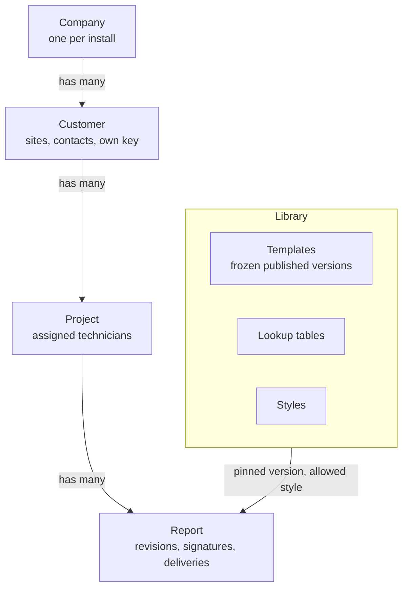
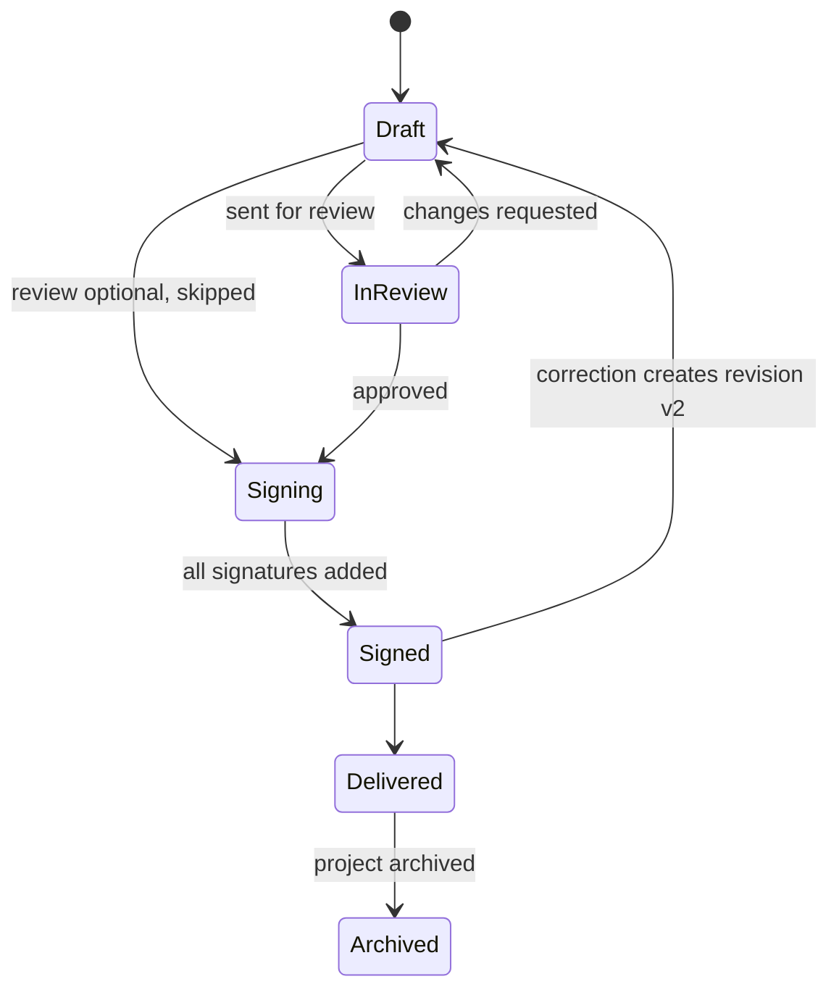
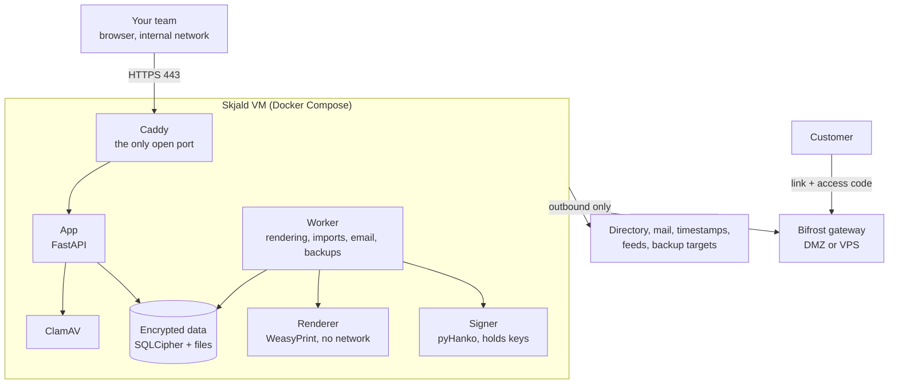

# Skjald architecture

This document describes how Skjald is designed. It is the reference for contributors and is updated as the design changes. Nothing here is built yet; see the roadmap at the end.

## Principles

- **One issuing company per install.** No multi-tenancy. Another company runs its own install.
- **Internal by default.** The app is reachable only on the internal network. The only part ever exposed to the internet is the optional Bifrost delivery gateway, which stores files it cannot read.
- **Security first.** Per-customer encryption keys, MFA for every account, need-to-know access and a tamper-evident audit log. The engineering baseline is OWASP ASVS Level 2.
- **Templates are files.** Every template, built-in or custom, exports and imports as one `.skjald` file.
- **Easy to install.** One command on a fresh Ubuntu Server LTS VM, plus a verifiable install path.
- **Reports worth keeping.** Signed, timestamped PDF/A files that still verify years later.

## Data model



- **Customer:** name, CVR, address, sites, contacts, logo, report language, default style, retention period, custom fields.
- **Project:** name, number, sites, dates, responsible technician, customer contact, classification, custom fields. An archived project and its reports are read-only.
- **Report:** numbered per type and year (for example `INC-2026-0142`) and pinned to one template version.

## Roles

| Role | Can |
| --- | --- |
| Administrator | Everything, including all customers, users, policies, keys, backups and breaking checkouts |
| Report Designer | Build templates, lookup tables, custom fields and styles |
| Technician | Create projects and reports for assigned customers, fill them in, upload data, sign, deliver |
| Reviewer | Review and countersign reports for assigned customers |
| Auditor | Read the audit log and report metadata |

Access to customer data is assignment-based. Nobody can review or countersign their own report.

## Report lifecycle



Technicians check out a section or a whole report before editing. Administrators can break stale checkouts. A signed report is locked; a correction becomes a new revision and the old one is kept as superseded.

## Templates

A template has three tabs:

- **Questions** — the form a technician fills in: fields, validation, defaults and repeating groups.
- **Layout** — the document, built by drag and drop: cover, headings, rich text with variables, tables bound to repeating groups, images, conditional and repeated sections, table of contents, signature blocks.
- **Data** — what the template can read: company, customer, project, report, answers, lookup tables and calculated values.

### Logic and the Skjald Expression Language (SEL)

Rules combine a condition (comparisons, ranges, AND / OR / XOR / NOT, IF / ELSE IF / ELSE, SWITCH, regular expressions) with actions (show or hide questions, sections and pages; set values; replace text; apply styles). A visual rule builder writes SEL, which power users can also edit as text.

SEL has no general loops, no file or network access and no code execution. Expressions have limits on size, steps and run time, and regular expressions use linear-time (RE2) semantics. The same SEL runs in the browser for the live form and on the server for the final render, kept identical by a shared conformance test suite. Phase 0 decides between writing SEL and adopting CEL.

### Versions and translation

Published template versions are frozen. Templates move between installs as `.skjald` files (a ZIP with manifest, questions, layout, rules, strings, styles and assets); imports are schema-validated and sanitised. To translate a template, copy it and edit its Strings view.

## Signing

Every report gets a PAdES signature with an RFC 3161 timestamp from an independent timestamp service and embedded revocation data, plus a visible signature block. Each template sets who signs: the company seal, the technician, or the technician followed by a reviewer. All signature fields, including the lock on the last one, are created before the first signature.

Signing runs in a separate **signer** container that holds the keys; the web-facing app never does. Keys are stored encrypted under the master key, and a user's key is used only after that user passes MFA. Certificates come from Skjald's built-in signing CA or from a commercial document-signing certificate, through a CSR flow so private keys never leave the server. The signer reaches keys through one interface, so a PKCS#11 HSM backend can be added later.

## Delivery

| Method | Release |
| --- | --- |
| Download | 1.0 |
| Email attachment (SMTP relay or Microsoft 365) | 1.0 |
| Password-protected PDF | 1.0 |
| Secure link with access code, through Bifrost | 1.1 |

Raw data travels beside the report as a separate encrypted bundle.

The PDF/A original is never encrypted, because PDF/A does not allow it. Encrypting a signed PDF afterwards breaks every signature (shown in [the PDF signing spike](../spikes/pdf-signing/README.md)). So when a report enters signing and its template allows password-protected delivery, Skjald generates the delivery password, stores it encrypted with the customer key, and each signer signs both the original and an encrypted copy in one action.

### Bifrost, the delivery gateway

Bifrost is a separate, optional service on its own small VM or VPS. It is the only part of Skjald that faces the internet.

1. Skjald encrypts each delivery with a fresh key and pushes the ciphertext to Bifrost. Connections only go from Skjald to Bifrost, never the other way.
2. The decryption key travels in the link after the `#`, which browsers never send to a server, so Bifrost never sees it.
3. The recipient enters an access code that was sent separately. Bifrost stores only a hash of it.
4. The recipient's browser downloads the ciphertext and decrypts it locally.
5. Bifrost deletes the files when the link expires or is revoked; Skjald collects access events into its audit log.

## Security model

### Keys

- **Master key** — a root-only file outside the data folder, never included in backups.
- **Database key** — opens the SQLCipher database; wrapped by the master key.
- **Customer keys** — generated per customer; encrypt that customer's files, answers, contacts and secrets. Deleting a customer destroys its key, so its data is unreadable everywhere, old backups included.
- **Signing keys** — held by the signer, wrapped by the master key.
- **Backup key** — separate; encrypts backups.

The setup wizard shows a recovery kit (master and backup keys) once. Without it, backups cannot be restored. Keeping the master key in a file protects stolen disks, backups and database copies, but not a running VM whose root account is compromised, so shell access to the VM must stay tightly limited.

### Audit log

Sign-ins, admin and permission changes, every view, download and export, secret reveals, signing, deliveries, key operations, backups and deletions are logged. Each entry carries the hash of the previous one, and the chain head is timestamped daily, so tampering shows.

### Hardening

- The PDF renderer has no network, a read-only filesystem and CPU, memory and time limits.
- Containers run as non-root with no extra capabilities.
- Rich text and SVG are sanitised; the browser gets a strict Content-Security-Policy.
- Secret fields are encrypted, masked by default, revealed only after MFA and always masked in PDFs.
- Uploads are checked against an admin-managed file type blocklist (by extension and content) and scanned with ClamAV.

## Components



Caddy is the single front door: it is the only open port, obtains and renews HTTPS certificates, and applies security headers, upload limits and the admin IP allowlist before a request reaches the app. The app and worker exchange jobs through a table in the encrypted database, so no separate queue server is needed.

| Part | Choice |
| --- | --- |
| Frontend | SvelteKit + TypeScript, built to static files |
| Backend | Python, FastAPI, SQLAlchemy |
| Database | SQLite + SQLCipher |
| PDF rendering | WeasyPrint (PDF/A-3b) |
| Signing | pyHanko |
| Rich text | TipTap |
| Proxy | Caddy |
| Backups | restic |
| Virus scanning | ClamAV |

## Deployment

- **Install:** one command on Ubuntu Server LTS installs Docker Engine if needed, generates keys, verifies the signed images and starts the stack. A web wizard then sets up the company, the break-glass administrator, the recovery kit, TLS, email and backups. A plain `docker-compose.yml` is also published.
- **Updates:** automatic by default, inside an admin-set maintenance window: verify signatures, back up, migrate, health-check, roll back on failure. Manual mode is available. The updater runs on the host, not in a container, because an updater container would need the Docker socket.
- **Backups:** encrypted restic backups to local disk, SMB shares or S3-compatible storage, with a scheduled restore test.

## Repository layout

```
frontend/    SvelteKit app
backend/     FastAPI app and background worker
renderer/    PDF renderer service
signer/      signing service
bifrost/     delivery gateway
templates/   built-in templates
deploy/      installer, compose files, Caddyfile
docs/        documentation and brand assets
```

## Roadmap

| Step | Scope |
| --- | --- |
| Phase 0 | Repository, CI and signed builds; design tokens; spikes for SEL vs CEL, PDF/A with several signatures, SQLCipher and the drag-and-drop builder |
| Phase 1 | Installer and setup wizard, local sign-in with MFA, roles and assignments, admin panel, customers and projects, keys, audit log, backups |
| Phase 2 | Template builder: tabs, field types, rules and SEL, lookup library, styles and page designer, preview, versions, template files |
| Phase 3 | Reports end to end: editor with checkout, uploads, review, rendering, signing, delivery, archive, retention, three built-in templates |
| 1.0 | Release gate: one-command install, ASVS Level 2 test plan passes, restore test green, all built-in templates sign end to end |
| 1.1 | Bifrost secure links |
| 1.2 | Active Directory and Entra ID sign-in, API tokens with IP allowlists, webhooks |
| 1.3 | Importers and vulnerability data feeds, more built-in templates |
| 1.4 | HSM support, syslog / SIEM forwarding, custom fonts |
